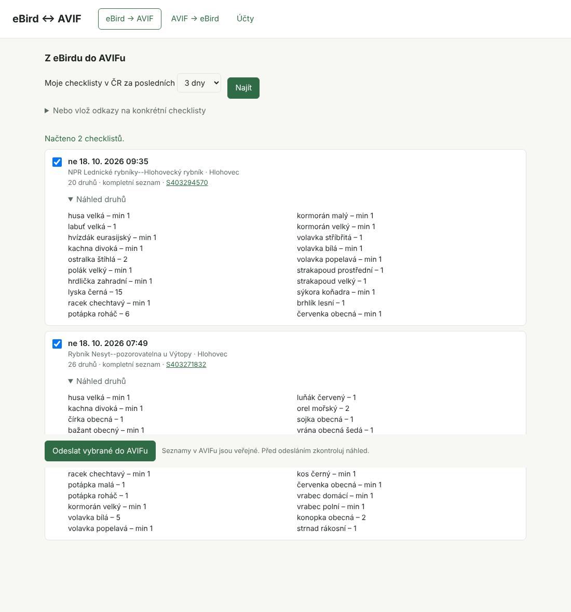
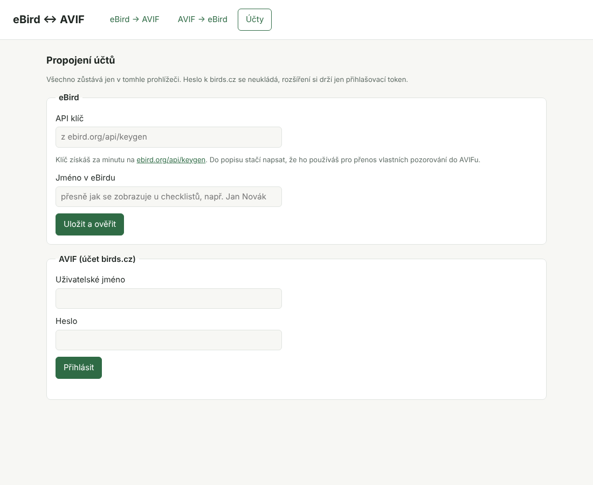

# eBird ↔ AVIF

Rozšíření do prohlížeče Chrome nebo Edge, které přenáší tvoje pozorování ptáků mezi [eBirdem](https://ebird.org) a českou faunistickou databází [AVIF](https://avif.birds.cz). Zadáváš do eBirdu a nechceš totéž přepisovat do AVIFu? Nebo naopak? Tohle to udělá za tebe.

- **Z eBirdu do AVIFu:** rozšíření najde tvoje checklisty z Česka, ukáže, jak budou vypadat v AVIFu, a vybrané tam jedním kliknutím založí.
- **Z AVIFu do eBirdu:** z vybraných seznamů v AVIFu připraví soubor, který nahraješ do eBirdu.



> **Neoficiální nástroj.** Rozšíření nevyvíjí Česká společnost ornitologická ani Cornell Lab of Ornithology. Vytvořil ho ptáčkař pro ptáčkaře.

## Obsah

1. [Co budeš potřebovat](#co-budeš-potřebovat)
2. [Instalace](#instalace)
3. [Propojení účtů](#propojení-účtů)
4. [Přenos z eBirdu do AVIFu](#přenos-z-ebirdu-do-avifu)
5. [Přenos z AVIFu do eBirdu](#přenos-z-avifu-do-ebirdu)
6. [Jak se data převádějí](#jak-se-data-převádějí)
7. [Časté otázky a potíže](#časté-otázky-a-potíže)
8. [Soukromí a bezpečnost](#soukromí-a-bezpečnost)
9. [Pro vývojáře](#pro-vývojáře)

## Co budeš potřebovat

- Počítač s prohlížečem **Google Chrome** nebo **Microsoft Edge** (Windows i Mac). Safari a Firefox zatím podporované nejsou, na mobilu rozšíření nefunguje.
- **Účet v eBirdu** a k němu osobní **API klíč**. Získáš ho zdarma za minutu, postup je níže.
- **Účet na birds.cz**, stejný, kterým se přihlašuješ do AVIFu.

## Instalace

Rozšíření zatím není v obchodě Chrome Web Store, instaluje se ručně. Zabere to dvě minuty a dělá se jen jednou.

1. Na této stránce klikni nahoře na zelené tlačítko **Code** a pak na **Download ZIP**.
2. Stažený soubor `ebird-avif-main.zip` rozbal. Na Macu stačí na něj dvakrát kliknout, ve Windows pravým tlačítkem → **Extrahovat vše**. Vznikne složka `ebird-avif-main`. Dej ji někam, kde zůstane (třeba do Dokumentů), protože prohlížeč z ní rozšíření načítá i nadále.
3. Do adresního řádku prohlížeče napiš `chrome://extensions` (v Edgi `edge://extensions`) a stiskni Enter.
4. Zapni přepínač **Režim pro vývojáře** (Chrome vpravo nahoře, Edge vlevo dole).
5. Klikni na **Načíst rozbalené** a vyber složku `ebird-avif-main`.
6. Rozšíření se objeví v seznamu. Klikni v liště prohlížeče na ikonu skládačky a u **eBird ↔ AVIF** na špendlík, ať máš ikonu stále po ruce.

Rozšíření otevřeš kliknutím na jeho ikonu, otevře se v nové kartě.

**Aktualizace:** stáhni nový ZIP, nahraď jím obsah složky a na stránce `chrome://extensions` klikni u rozšíření na šipku **Znovu načíst**. Nastavení i seznam přenesených checklistů zůstanou zachované.

## Propojení účtů

Při prvním spuštění se otevře záložka **Účty**.



### eBird API klíč

API klíč je osobní kód, kterým eBird povolí rozšíření číst tvoje checklisty.

1. Přihlas se do eBirdu a otevři [ebird.org/api/keygen](https://ebird.org/api/keygen).
2. Vyplň formulář, stačí třeba takhle:
   - **Project Title:** `eBird to AVIF`
   - **Description of Use:** `Personal use: transferring my own eBird checklists to the Czech bird database AVIF (avif.birds.cz).`
   - **Project Type:** nech `General`
3. Po odeslání se klíč zobrazí na stránce. Zkopíruj ho.
4. V rozšíření ho vlož do pole **API klíč**.
5. Do pole **Jméno v eBirdu** napiš své jméno přesně tak, jak se zobrazuje u tvých checklistů (například `Jan Novák`). Podle něj rozšíření pozná, které checklisty jsou tvoje.
6. Klikni na **Uložit a ověřit**. Když je vše v pořádku, objeví se „Uloženo, klíč funguje.“

### AVIF

1. Vyplň **uživatelské jméno** a **heslo** ke svému účtu na birds.cz.
2. Klikni na **Přihlásit**.

Heslo se nikam neukládá. Rozšíření si drží jen přihlašovací token, podobně jako když na webu zaškrtneš „zůstat přihlášen“.

## Přenos z eBirdu do AVIFu

1. Otevři záložku **eBird → AVIF**.
2. Vyber období (3 až 30 dní zpátky) a klikni na **Najít**. Rozšíření projde checklisty z Česka a vybere ty tvoje.
   - Konkrétní checklist načteš i přes **Nebo vlož odkazy na konkrétní checklisty**. Vlož odkaz typu `https://ebird.org/checklist/S123456789`, jde jich vložit víc najednou.
3. U každého checklistu uvidíš datum, lokalitu, obec, počet druhů a jestli půjde o kompletní, nebo částečný seznam. Po rozkliknutí **Náhled druhů** uvidíš česká jména a počty, přesně jak se uloží do AVIFu.
4. Zaškrtni checklisty, které chceš přenést. Ty, které už v AVIFu jsou, mají štítek **V AVIFu** a zaškrtnout nejdou.
5. Klikni na **Odeslat vybrané do AVIFu** a potvrď.

Po odeslání se u checklistu objeví štítek **V AVIFu**. Klikem na něj otevřeš nový seznam přímo v AVIFu, kde ho můžeš dál upravit, třeba doplnit hnízdní kategorii, pohlaví nebo poznámky.

**Štítky u checklistů:**

| Štítek | Co znamená |
|---|---|
| **V AVIFu** | už přeneseno, podruhé se neodešle. **Přenést znovu** použij jen tehdy, když jsi seznam v AVIFu smazal(a). |
| **N druhů nespárováno** | některé druhy nemají v AVIFu protějšek (typicky hybridy). Zbytek se přenese jako částečný seznam, chybějící druhy doplň v AVIFu ručně. |
| **Nelze přenést** | checklist je mimo Česko, nebo se nepodařilo zjistit lokalitu. Důvod je uvedený pod názvem. |

## Přenos z AVIFu do eBirdu

eBird neumožňuje aplikacím zapisovat data přímo. Rozšíření proto připraví soubor CSV a ty ho do eBirdu nahraješ sám. Je to jeden krok navíc, ale eBird ti při nahrání ukáže kontrolu, než data uloží.

1. Otevři záložku **AVIF → eBird**.
2. Vyber období a klikni na **Načíst**. Zobrazí se tvoje seznamy z AVIFu.
   - Seznamy, které do AVIFu přišly z eBirdu, mají štítek **Pochází z eBirdu** a zpět se nenabízejí, aby v eBirdu nevznikly duplicity.
   - Už exportované seznamy mají štítek **Exportováno** a nejsou předem zaškrtnuté.
3. Zaškrtni seznamy, které chceš přenést, a klikni na **Stáhnout CSV pro eBird**. Soubor se uloží do Stažených souborů.
4. Klikni na **Otevřít import v eBirdu**, nebo otevři [ebird.org/import](https://ebird.org/import/upload.form?theme=ebird).
5. Jako formát zvol **eBird Record Format (Extended)**, vyber stažený soubor a nahraj ho.
6. eBird tě provede kontrolou. Hlavně u lokalit nabídne spojení s existujícím hotspotem nebo uložení jako tvoje vlastní lokalita. Pak checklisty potvrdíš.

## Jak se data převádějí

### Z eBirdu do AVIFu

| eBird | AVIF |
|---|---|
| datum a čas začátku | datum, čas od |
| délka pozorování | čas do |
| „Hlásíte všechny druhy?“ ano | kompletní seznam |
| příležitostné pozorování, nebo některý druh nespárován | částečný seznam |
| stacionární protokol | režim „bod“, jinak „oblast“ |
| lokalita | souřadnice a název lokality, obec se určí podle souřadnic |
| ušlá vzdálenost, počet pozorovatelů | ušlá vzdálenost, počet pozorovatelů |
| počet | počet; „X“ (přítomen, bez počtu) se uloží jako „min 1“ |
| — | poznámka „Převedeno z eBirdu“ s odkazem na checklist |

Nepřenáší se: komentáře k druhům a k checklistu, fotky a zvukové nahrávky, věk a pohlaví, hnízdní kódy. eBird je aplikacím nezpřístupňuje. Doplnit je můžeš v AVIFu ručně.

### Z AVIFu do eBirdu

| AVIF | eBird |
|---|---|
| datum, čas od–do | datum, čas začátku, délka |
| kompletní seznam s vyplněným časem | „všechny druhy nahlášeny“ |
| seznam bez času | příležitostné pozorování |
| ušlá vzdálenost | protokol „Traveling“ se vzdáleností, jinak „Stationary“ |
| počet „35“, „cca 40“, „min 12“ | 35, 40, 12 |
| „min 1“, rozpětí nebo „max“ | X (přítomen) |
| poznámky | komentáře, plus odkaz na seznam v AVIFu |

### Druhy

Rozšíření páruje druhy podle latinských jmen. Kde se taxonomie eBirdu a AVIFu liší, používá ruční převodní tabulku. Například vrána šedá je v eBirdu samostatný druh, kdežto v AVIFu poddruh vrány obecné. Párování pokrývá všechny ptačí taxony AVIFu. Hybridy a exotické druhy, které AVIF nevede, se nepřenesou a rozšíření je vypíše.

## Časté otázky a potíže

**Rozšíření nenašlo můj checklist.**
- Zkontroluj, že máš v záložce **Účty** jméno přesně jako u checklistů v eBirdu, včetně diakritiky.
- Hledají se jen checklisty z Česka. AVIF jiné nepřijímá.
- Checklist načteš vždy i vložením odkazu na něj.

**Rozšíření píše „eBird odmítl API klíč“.**
Klíč je zkopírovaný špatně (chybí znak, mezera navíc), nebo byl zrušen. Na [ebird.org/api/keygen](https://ebird.org/api/keygen) si ho zobraz znovu a vlož ho celý.

**Rozšíření píše „Přihlášení k AVIFu vypršelo“.**
V záložce **Účty** se odhlas a znovu přihlas.

**Omylem jsem něco odeslal do AVIFu.**
Otevři seznam v AVIFu (štítek **V AVIFu**) a uprav nebo smaž ho přímo tam. Když ho smažeš a budeš ho chtít poslat znovu, klikni u checklistu v rozšíření na **Přenést znovu**.

**Odešle se něco samo, bez mého potvrzení?**
Ne. Do AVIFu se odesílá jen po kliknutí na **Odeslat** a potvrzení.

**Kdo uvidí přenesená data?**
Stejní lidé jako u jakéhokoli tvého seznamu v AVIFu. Platí viditelnost podle nastavení tvého účtu v AVIFu a utajení vzácných druhů podle pravidel ČSO.

**Funguje to i na Slovensku?**
Zatím ne. AVIF přijímá jen pozorování z Česka.

**Jak rozšíření odinstaluju?**
Na `chrome://extensions` klikni u rozšíření na **Odstranit**. Smažou se tím i všechna uložená nastavení.

Narazil(a) jsi na chybu nebo máš nápad? Založ [issue](../../issues) a připoj datum a odkaz na checklist či seznam, kterého se to týká.

## Soukromí a bezpečnost

Rozšíření nemá žádný server a nic nesbírá. API klíč, přihlašovací token a seznam přenesených checklistů zůstávají jen ve tvém prohlížeči. Data putují přímo mezi tvým prohlížečem a servery eBirdu a AVIFu. Autor rozšíření k nim nemá přístup. Podrobnosti jsou v [zásadách ochrany soukromí](PRIVACY.md).

## Pro vývojáře

Čisté JavaScript rozšíření (Manifest V3) bez závislostí a bez build kroku.

```
npm test            # testy převodů (Node 20+)
npm run taxonomy    # znovu vygeneruje data/taxonomy.json z aktuálních taxonomií eBirdu a AVIFu
npm run zip         # balíček pro Chrome Web Store
```

| Soubor | Co dělá |
|---|---|
| `src/lib/convert.js` | převody mezi formáty (čisté funkce, testované) |
| `src/lib/ebird.js` | klient [eBird API 2.0](https://documenter.getpostman.com/view/664302/S1ENwy59) (jen čtení) |
| `src/lib/avif.js` | klient [API AVIFu v3](https://avif.birds.cz/api/v3/docs/) |
| `src/lib/taxonomy-build.js` | párování taxonomií a ruční výjimky |
| `data/taxonomy.json` | vygenerovaná převodní tabulka druhů |
| `src/app.*` | uživatelské rozhraní |

Technické poznámky:
- Detail checklistu v eBird API neobsahuje souřadnice. Rozšíření je proto hledá v denním přehledu checklistů kraje, u hotspotů záložně v jejich detailu.
- Vlastní checklisty eBird API nevypisuje. Hledají se v denních přehledech za ČR podle jména. Když přehled narazí na strop 200 checklistů za den, rozšíření se ptá po krajích.
- API AVIFu přijímá požadavky z webových stránek jen z vlastní domény. Rozšíření má hostitele povolené v manifestu, takže potřebuje jen přihlášení uživatele.

Úpravu párování druhů (pole `OVERRIDES` v `taxonomy-build.js`) nebo jinou opravu pošli jako pull request.

## Licence

[MIT](LICENSE)
